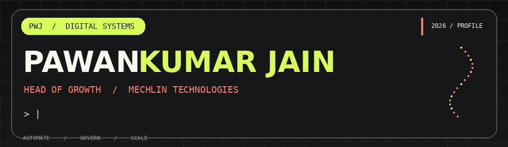

**AI Governance & Agentic AI** &nbsp; / &nbsp; **Enterprise Solutions** &nbsp; / &nbsp; **GTM & Strategic Partnerships**

## 01 / BUILDING AT THE INTERSECTION OF AI + GROWTH

I'm **Pawan Kumar Jain**, **Head of Growth @ Mechlin Technologies**. I connect AI strategy, engineering, automation, and business development to turn complex workflows into practical enterprise solutions.

I bring **10+ years of professional experience** across AI solutions, product and business analysis, CRM automation, digital commerce, and analytics. My work includes agent-assisted workflows, AI-enabled lead management, API integrations, and cross-functional product delivery.

> **My focus:** Making AI not only capable, but controlled, measurable, and valuable to the business.

| **STRATEGY / 01** | **ENGINEERING / 02** | **TRUST / 03** |
|:---|:---|:---|
| AI-led growth, GTM, partnerships | Agents, APIs, CRM and workflow automation | AI governance, runtime controls, evaluation |

## 02 / CURRENT FOCUS

| Direction | What I'm exploring and building |
|:---|:---|
| **Agentic AI** | Tool-using agents, workflow orchestration, human-in-the-loop review |
| **AI Governance** | AI inventory, risk-based controls, execution-time authorization, traceability |
| **AI Automation** | n8n, API orchestration, lead routing, CRM operations and process automation |
| **Enterprise Growth** | GTM engineering, AI adoption, scalable solutions and strategic partnerships |

## 03 / AI GOVERNANCE — CONTROL AT RUNTIME

For an AI agent, **access is not the same as authority**. A robust deployment needs more than policy documents: approval checks, revocation handling, human oversight, evaluations, and evidence of what actually happened.

- **Govern & inventory:** ownership, intended use, risk classification
- **Protect:** privacy, least privilege, data security
- **Enforce:** runtime authorization, approval validity, emergency stops
- **Verify:** adversarial scenarios, output evaluations, prohibited-action testing
- **Assure:** logging, monitoring, auditability and incident response

*Reference frameworks:* NIST AI RMF · ISO/IEC 42001 · EU AI Act, where applicable. These are areas of focus, not a claim of formal certification in these frameworks.

## 04 / SELECTED PUBLIC REPOSITORIES

| Project | Why it matters | Code |
|:---|:---|:---|
| **Neuralflow** | AI consulting website | [Explore ↗](https://github.com/pkoffice1994/neuralflow) |
| **Sahay.ai** | Software project | [Explore ↗](https://github.com/pkoffice1994/Sahay.ai) |
| **Indianews** | Python project | [Explore ↗](https://github.com/pkoffice1994/indianews) |
| **AI News Portal** | Web project | [Explore ↗](https://github.com/pkoffice1994/ainewsportal) |
| **Woodspace Website** | Website project | [Explore ↗](https://github.com/pkoffice1994/woodspace-website) |
| **Adinath Enterprises** | Website project | [Explore ↗](https://github.com/pkoffice1994/adinath-enterprises) |

**Selected professional case studies** (from my resume; not presented as public source-code repositories):

- **NeuralFlow AI Workflow Automation Engine:** modular input → decision → action workflow with API integrations.
- **AI Lead Generation & Automation Agent:** chatbot-based lead capture and qualification.
- **AI News Automation System:** fetching, rewriting and publishing workflow.

## 05 / TECH + DELIVERY TOOLKIT

**AI & orchestration** · LLM integration · AI Agents · Prompt Engineering · n8n · REST APIs

**Engineering & cloud** · Python · JavaScript · AWS · Google Cloud · Docker · Git/GitHub · CI/CD

**Data & platforms** · SQL · PostgreSQL · MongoDB · Power BI · HubSpot/CRM · Adobe Commerce / Magento

**Business delivery** · Agile · UAT · Product Delivery · GTM Strategy · Strategic Partnerships

## 06 / TRACK RECORD

| Experience | Highlights |
|:---|:---|
| **Head of Growth @ Mechlin Technologies** | AI-led growth, strategic partnerships, enterprise solutions *(current headline)* |
| **Kriscent Techno Hub** | AI automation and growth work *(resume-listed role)* |
| **Independent Consulting** | CRM, WhatsApp and workflow automation |
| **ALLEN Digital** | Business analysis, product delivery, analytics and data pipelines |
| **ETOOS Education / GirnarSoft** | E-commerce analytics, business analysis and web solutions |

**Education:** B.Tech, Information Technology — IET Alwar (2013)

**Credentials listed on my resume:** Oracle Cloud Infrastructure DevOps Professional (2025) · Tata GenAI Data Analytics Job Simulation (2025) · AI/Prompt Engineering · AI Tools & Automation

## 07 / GITHUB + WHAT'S NEXT

My public code, activity, and latest repositories are available directly on [**GitHub → @pkoffice1994**](https://github.com/pkoffice1994?tab=repositories). For the live contributions calendar, [**see my GitHub overview →**](https://github.com/pkoffice1994).

*No fragile third-party contribution graph is embedded, so there's no broken empty activity panel.*

## 08 / LET'S BUILD SOMETHING USEFUL

I enjoy working with founders, engineering teams and enterprise stakeholders on **responsible AI deployment**, **intelligent automation**, and **AI-powered business growth**.

[**LinkedIn ↗**](https://www.linkedin.com/in/pawan-kumar-jain-ab19a0217/) &nbsp; · &nbsp; [**Portfolio ↗**](https://pawan-portfolio-ryhg.onrender.com/) &nbsp; · &nbsp; [**Neuralflow ↗**](https://neuralflow-gold.vercel.app/) &nbsp; · &nbsp; [**Email ↗**](mailto:pkoffice1994@gmail.com)

---

DESIGN / 2026 &nbsp; • &nbsp; PAWAN KUMAR JAIN &nbsp; • &nbsp; AUTOMATE / GOVERN / SCALE

